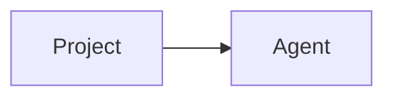

import Tabs from '@theme/Tabs';
import TabItem from '@theme/TabItem';

A project groups agents. See [MCP proxies](../guides/register-mcp-proxy.mdx#register).

:::caution
Deleting a project deletes its agents.
:::

<Tabs>
<TabItem value="console" label="Console">

Open the console.

</TabItem>
</Tabs>
